<div align="center">

# DataProfile

**Notebook-normalized portfolio telemetry for data scientists, ML engineers, analysts, and researchers**

[](go.mod)
[](LICENSE)
[](#the-four-visualization-schools-school)
[](#the-four-analytical-panels-panel)

<p align="center">
  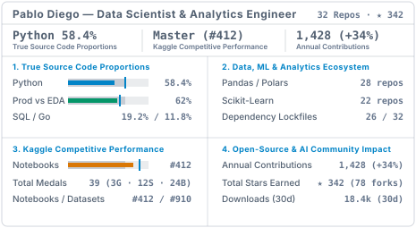
  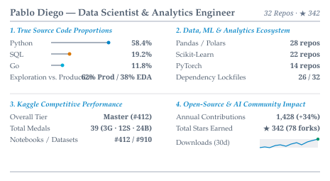
</p>

</div>

## Why DataProfile exists

Standard GitHub profile generators were built for general software engineers. When applied to someone who works with data, machine learning, or quantitative research, those generators misrepresent the portfolio for three concrete reasons.

First, GitHub Linguist measures language share by raw file bytes, which includes embedded base64 PNG plots, HTML table dumps, and execution metadata stored inside `.ipynb` files. Because a single Jupyter notebook with three `matplotlib` charts can weigh 4 MB while 15,000 lines of `.py`, `.sql`, and `.go` modules weigh less than 500 KB, the profile ends up labeled as 94% Jupyter Notebook. DataProfile parses `.ipynb` JSON trees and strips cell output payloads before counting bytes, separating exploratory notebooks (EDA) from production modules.

Second, knowing that a practitioner writes Python or R says very little about their actual work. What distinguishes a data engineer from a computer vision researcher is the set of libraries declared inside `pyproject.toml`, `requirements.txt`, `environment.yml`, and `DESCRIPTION` (such as Polars, DuckDB, PyTorch, Scikit-Learn, dbt, or Streamlit), together with engineering habits like dependency lockfiles, CI workflows, automated tests, and Dockerfiles.

Third, a data professional's public work rarely lives on GitHub alone. Competition rankings, datasets, and notebooks often sit on Kaggle, while pretrained weights and demos live on Hugging Face Hub. Instead of displaying those signals in generic cards, DataProfile renders them using four classic schools of information design (`tufte`, `few`, `cairo`, and `holmes`).

## The four analytical panels (`Panel`)

DataProfile compiles metrics from GitHub, Kaggle, and Hugging Face Hub into four modular panels (plus a consolidated `summary.svg`). Every file uses a transparent canvas (`fill="none"`) and a dual-surface palette calibrated for WCAG AA contrast on both GitHub Light (`#ffffff`) and GitHub Dark (`#0d1117`):

| Panel File | Domain Focus | Key Engineering & Data Signals |
| :--- | :--- | :--- |
| **`languages.svg`** | Code, Notebooks & Engineering Hygiene | Strips embedded base64 chart bloat from `.ipynb` files to recover true source code proportions, measures the Exploration (EDA) vs. Production split, and counts repositories with lockfiles, CI/CD, test suites, and Docker. |
| **`stack.svg`** | Data, ML & Analytics Ecosystem | Scans dependency manifests across three pillars: Data & Analytics (`Pandas/Polars`, `SQL/DuckDB`, `Apache Spark`, `dbt/Airflow`), Machine Learning & AI (`Scikit-Learn`, `PyTorch`, `XGBoost/LightGBM`, `Hugging Face`), and Visualization & Data Apps (`Plotly/Dash`, `Streamlit`, `Matplotlib/Seaborn`, `ggplot2`). |
| **`kaggle.svg`** | Kaggle Standing & Medals | Combines headless Chrome CDP extraction with optional Kaggle REST API v1 calls to display Overall Tier (`Novice` to `Grandmaster`), global peak rank, cumulative medals (Gold, Silver, Bronze), and percentile standing across Notebooks, Datasets, Competitions, and Discussions. |
| **`impact.svg`** | Open-Source & AI Community Impact | Joins GitHub reach (annual contributions, 52-week trend, stars, public repos, forks, 14-day views) with Hugging Face Hub metrics (published models, datasets, spaces, 30-day downloads, and community likes). |

If a metric is zero, the renderer adapts the layout rather than printing rows of zeros. For instance, when a practitioner has zero Gold medals on Kaggle or no published models on Hugging Face Hub, the panel shifts that space to active progression tracks or GitHub engineering velocity.

## The four visualization schools (`School`)

Each run generates all five panels across four visualization schools under `generated/<school>/<panel>.svg`. None of the generated SVGs print the name of the school or its author inside the image, which allows you to adopt a single visual grammar or mix panels from different schools in the same profile.

### I. `generated/tufte/` (Edward Tufte)

Inspired by **Edward Tufte** (*The Visual Display of Quantitative Information*, 1983), this grammar removes outer boxes and grid cages so that every line serves the data. It uses serif typography with tabular numerals, dot-dash plots for language share, supertables for Kaggle percentiles, and inline sparklines with interquartile shading.

<p align="center">
  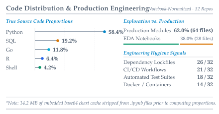
  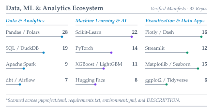
</p>
<p align="center">
  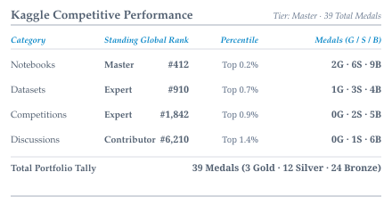
  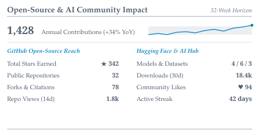
</p>

### II. `generated/few/` (Stephen Few)

Inspired by **Stephen Few** (*Information Dashboard Design*, 2006), this layout is organized for three-second scanning by technical recruiters and engineering managers. It pairs top KPI strips with bullet graphs (qualitative background bands, an inner performance bar, and a vertical target threshold marker) and reserves accent color for category leaders.

<p align="center">
  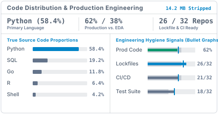
  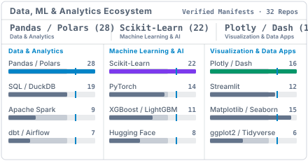
</p>
<p align="center">
  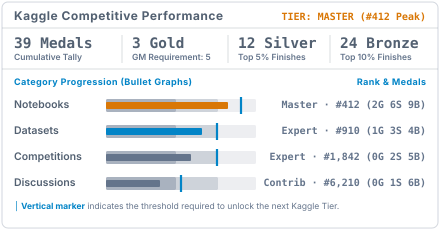
  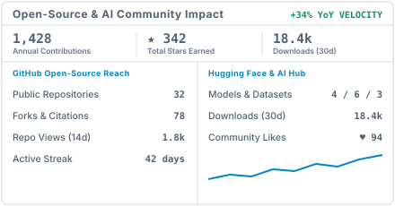
</p>

### III. `generated/cairo/` (Alberto Cairo)

Inspired by **Alberto Cairo** (*The Functional Art*, 2012; *The Truthful Art*, 2016), this school treats the portfolio like an editorial data-journalism piece. It combines a crimson top rule with a thesis-driven serif headline, a 10x5 waffle chart for code structure, lollipop charts with dashed benchmark lines, and an annotation layer (`↳`) that explains what the numbers mean in context.

<p align="center">
  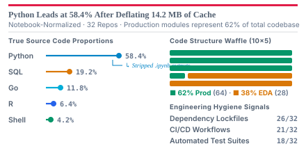
  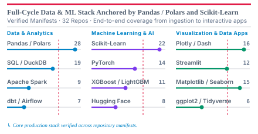
</p>
<p align="center">
  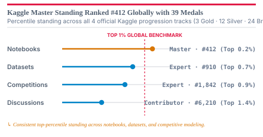
  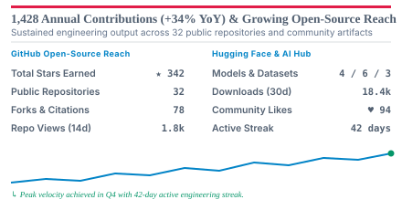
</p>

### IV. `generated/holmes/` (Nigel Holmes & ISOTYPE)

Inspired by **Nigel Holmes** (*Designer's Guide to Creating Charts and Diagrams*, 1984) and Otto Neurath's ISOTYPE system, this grammar uses magazine header ribbons, 10-block pictorial unit charts (where each block equals 10% of the codebase), a stepped podium showing progression toward Kaggle Grandmaster, and visual badges for engineering practices.

<p align="center">
  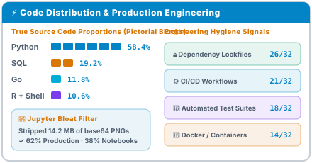
  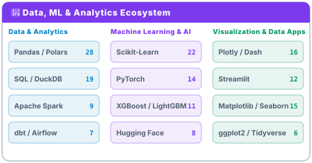
</p>
<p align="center">
  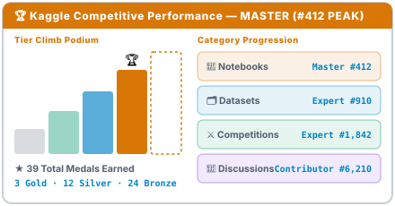
  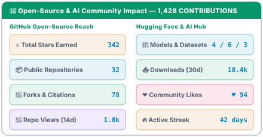
</p>

## 2-Minute Setup Guide

You can run DataProfile either by adding the **GitHub Marketplace Action** directly to your `<username>/<username>` profile repository or by **forking** this repository. Neither option requires editing Go code.

### Option A: Use the GitHub Marketplace Action (no fork required)

1. Create a [`profile.yaml`](profile.yaml) file in your `<username>/<username>` profile repository with your public usernames and preferred locale (`"en"` or `"pt-BR"`):

```yaml
subject:
  name: "Your Name"
  role: "Data Scientist & ML Engineer"
  locale: "en" # "en" or "pt-BR"

sources:
  github:
    username: "your-github-username"
    include_forks: false
    exclude_langs: ["HTML", "CSS", "TeX"]
  kaggle:
    username: "your-kaggle-username"
    enabled: true
    mode: "hybrid"
  huggingface:
    username: "your-hf-username"
    enabled: true
```

2. Add `.github/workflows/dataprofile.yml` to your repository:

```yaml
name: Generate DataProfile SVGs

on:
  schedule:
    - cron: "0 6 * * *"
  workflow_dispatch:
  push:
    branches: [main]
    paths: ["profile.yaml"]

permissions:
  contents: write

jobs:
  dataprofile:
    runs-on: ubuntu-latest
    steps:
      - uses: actions/checkout@v4
      - name: Generate and validate DataProfile SVGs
        uses: pablodiegoo/dataprofile@v1
        with:
          config: "profile.yaml"
          output: "generated"
          github-token: ${{ secrets.ACCESS_TOKEN || github.token }}
          kaggle-username: ${{ secrets.KAGGLE_USERNAME }}
          kaggle-key: ${{ secrets.KAGGLE_KEY }}
```

### Option B: Fork this repository

1. Click **Fork** at the top-right of this page.
2. Open the **Actions** tab in your fork and click **"I understand my workflows, go ahead and enable them"** (GitHub disables scheduled workflows on fresh forks by default).
3. Edit [`profile.yaml`](profile.yaml) on `main` with your usernames and commit. The bundled workflow ([`.github/workflows/generate.yml`](.github/workflows/generate.yml)) will compile the engine, validate all 20 SVGs, and publish them (along with a ready-to-copy catalog `README.md`) to the orphan `output` branch of your fork using the built-in `GITHUB_TOKEN`.

### Optional secrets for private metrics and Kaggle REST API v1

The default setup works without manual secrets. If you also want private repository counts, 14-day traffic views, or Kaggle REST API v1 enrichment, open **Settings -> Secrets and variables -> Actions** and add:

- `ACCESS_TOKEN`: A GitHub Personal Access Token (`read:user`, `repo`). When omitted, the workflow falls back to the automatic `GITHUB_TOKEN`.
- `KAGGLE_USERNAME` and `KAGGLE_KEY`: Optional Kaggle credentials (accepts both `KGAT_...` Bearer tokens and classic `kaggle.json` keys). Even without them, the `hybrid` collector extracts public tiers, ranks, and medals via headless Chrome on the GitHub Actions runner.

Never commit tokens to `profile.yaml`. Local `.env` files are excluded via [`.gitignore`](.gitignore); see [`.env.example`](.env.example) for local runs.

### Embed the panels in your profile `README.md`

Once the workflow publishes to the `output` branch, paste the snippet for your preferred school into your `<username>/<username>` profile `README.md` (replace `/few/` with `/tufte/`, `/cairo/`, or `/holmes/`, or mix schools across panels):

```markdown
<p align="center">
  /dataprofile/output/generated/few/languages.svg" width="48%" alt="Languages & Engineering" />
  /dataprofile/output/generated/few/stack.svg" width="48%" alt="Data & ML Stack" />
</p>
<p align="center">
  /dataprofile/output/generated/few/kaggle.svg" width="48%" alt="Kaggle Standing" />
  /dataprofile/output/generated/few/impact.svg" width="48%" alt="Community Impact" />
</p>
<p align="center">
  <sub>Generated with <a href="https://github.com/pablodiegoo/dataprofile">DataProfile</a></sub>
</p>
```

## Local CLI usage and repository layout

Because the engine uses only the Go 1.23+ standard library, you can run and test everything locally without installing external dependencies:

```bash
# Generate all 20 SVGs (4 Schools x 5 Panels) using live APIs and profile.yaml
go run ./cmd/dataprofile generate --config=profile.yaml

# Generate deterministic showcase SVGs in offline demo mode
go run ./cmd/dataprofile generate --demo

# Render all panels in Brazilian Portuguese (pt-BR)
go run ./cmd/dataprofile generate --demo --locale=pt-BR

# Validate XML well-formedness, dual-surface contrast, and absence of school meta-labels
go run ./cmd/dataprofile validate

# Run the automated unit and integration test suite
go test -v ./...
```

```text
dataprofile/
├── cmd/dataprofile/main.go                  # CLI entrypoint (generate and validate subcommands)
├── internal/
│   ├── domain/model.go                      # Canonical domain types (School, Panel, Palette, PortfolioData)
│   ├── config/                              # Declarative profile.yaml and .env loader
│   ├── normalizer/                          # Jupyter .ipynb base64 deflator and 3-pillar Stack scanner
│   ├── sources/{github,kaggle,huggingface}/ # Concurrent upstream Source collectors
│   └── render/                              # Parameterized SVG engine (4 Schools x 5 Panels, en and pt-BR)
├── prototypes/                              # Interactive HTML/SVG viewer (prototypes/index.html)
├── generated/{tufte,few,cairo,holmes}/      # Rendered SVG panels and output branch README
├── GLOSSARY.md                              # Domain vocabulary definitions
└── docs/adr/                                # Architectural Decision Records (ADR-0001, ADR-0002)
```

## Contributing, security, and license

Please read [`CONTRIBUTING.md`](CONTRIBUTING.md), [`GLOSSARY.md`](GLOSSARY.md), and [`docs/adr/`](docs/adr/) before opening a pull request. Community interactions follow our [`CODE_OF_CONDUCT.md`](CODE_OF_CONDUCT.md), and credential or vulnerability concerns should be reported privately according to [`SECURITY.md`](SECURITY.md).

DataProfile is licensed under the [Apache License, Version 2.0](LICENSE). Under Section 4(d) of the license, any redistribution or derivative work must preserve the attribution notice in [`NOTICE`](NOTICE) referencing the original repository (`https://github.com/pablodiegoo/dataprofile`) and author (Pablo Diego). The serverless GitHub Actions SVG workflow pattern was inspired by prior open-source projects [`jstrieb/github-stats`](https://github.com/jstrieb/github-stats) and [`rahul-jha98/github-stats-transparent`](https://github.com/rahul-jha98/github-stats-transparent); DataProfile is an independent implementation written from scratch in Go.
